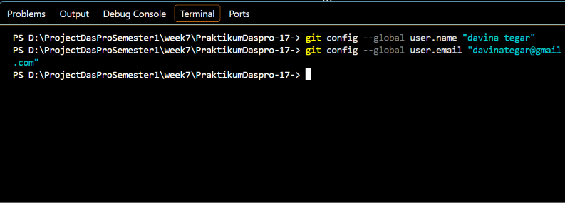
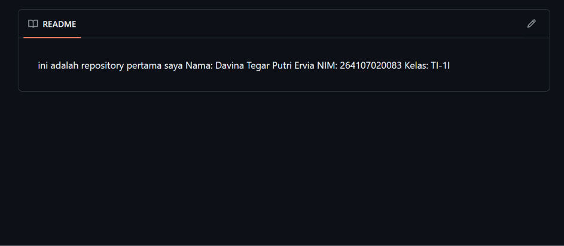
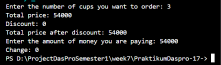
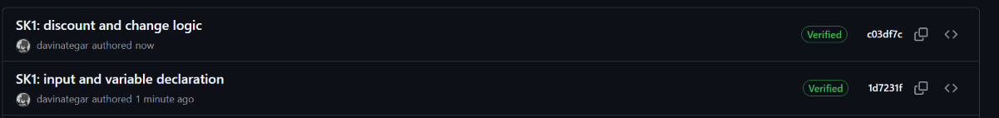

# REPORT JOBSHEET 6: CASE STUDY: SELECTION STRUCTURES WITH GIT AND GITHUB

Name: Davina Tegar Putri Ervia

Student ID: 246107020083

GitHub: https://github.com/davinategar

# 1. Learning Objective
a. Students are able to solve case studies using basic and nested selection structures

b. Students are able to save and submit their work using Git and GitHub through Visual StudioCode

c. Students are able to collaborate with classmates using GitHub

## 2. Practical Session

### 2.1 Initial Setup (done once on each laptop/PC)



## 3. EXPERIMENT 1: Setting up a repository



## 4. EXPERIMENT 2: Case Study — Basic Selection

Kedai Kopi Senja (Senja Coffee Shop) sells Kopi Susu Gula Aren (Palm Sugar Milk Coffee) for Rp18,000 per cup and gives a 10% discount on purchases of at least Rp100,000. The shop owner needs a simple cashier program to calculate the total payment and the change. Write a Java program based on the flowchart below.

### 4.1 Java Code Program

```
import java.util.Scanner;

public class CaseStudy1_17 {
    public static void main(String[] args) {
        Scanner sc = new Scanner(System.in);

        int coffeePriceEachCup = 18000;
        int cupQuantity, moneyPaid, totalPrice, discount, change, notEnoughMoney;
        int totalPriceAfterDiscount;

        System.out.print("Enter the number of cups you want to order: ");
        cupQuantity = sc.nextInt();
        totalPrice = coffeePriceEachCup * cupQuantity;
        discount = totalPrice >= 100000 ? totalPrice * 10 / 100 : 0;
        totalPriceAfterDiscount = totalPrice - discount;

        System.out.println("Total price: " + totalPrice);
        System.out.println("Discount: " + discount);
        System.out.println("Total price after discount: " + totalPriceAfterDiscount);

        System.out.print("Enter the amount of money you are paying: ");
        moneyPaid = sc.nextInt();

        if (moneyPaid >= totalPriceAfterDiscount) {
            change = moneyPaid - totalPriceAfterDiscount;
            System.out.println("Change: " + change);
        } else {
            notEnoughMoney = totalPriceAfterDiscount - moneyPaid;
            System.out.println("Not enough money: " + notEnoughMoney);
        }

        sc.close();
    }
}

```

### 4.2 Output Screenshot



### 4.3 Add to GitHub

Requirements for the work and for saving it with Git:

1. Create a file named StudiKasus1<NoPresensi>.java inside the repository PraktikumDaspro<NoPresensi>.

2. Make at least 2 commits with clear commit messages, for example the first commit after finishing the input and variable declarations ("SK1: input and variable declaration"), and the second commit after finishing the selection logic ("SK1: discount and change logic").

3. Push your code once it is finished.



## 5. EXPERIMENT 3: Case Study 2 — Nested Selection

The Student Affairs Division of Politeknik Negeri Malang has issued a letter regarding the verification of complete achievement documents for students in Activity Year 2026, Stage I. Based on the requirements in that letter, the institution's award funds are given to students under the following conditions:

- For competitions organized by BELMAWA, BAKORMA, or independently (Mandiri), award funds are given only to students who win 1st, 2nd, or 3rd place. Honorable Mention winners or regular participants do not receive award funds.
- For the Student Creativity Program (PKM), award funds are given to teams whose proposals are approved for funding.
- Activities outside the two conditions above (Other) do not receive award funds.

In addition, students who meet condition a or b are required to upload 4 complete documents to SIAKAD: the Assignment Letter, Certificate, Activity Photo, and Activity Poster. If fewer than 4 documents are uploaded, the data is considered incomplete and no award funds are given.

Write a program to help the Student Affairs Admin check the status of a student's award funds. The program should only ask for the data needed based on the type of activity, then display the award fund status along with the reason. If the documents are incomplete, also display how many documents are still missing. Solve this using nested selection (nested IF) with a maximum depth of 3 levels. Use the following input data requirements:

| Data                      | Input requirements                                              |
|---------------------------|-----------------------------------------------------------------|
| Student name              | Text                                                            |
| Type of activity          | Text: BELMAWA, BAKORMA, Mandiri, PKM, or Lainnya (Other) — not case-sensitive |
| Number of documents uploaded | Number, 0-4                                                   |
| Competition rank          | Number 1, 2, or 3; enter 0 if not a winner                       |
| PKM funding status        | Number: 1 = approved, 0 = not approved                           |

### 5.1 Java Code Program

```
import java.util.Scanner;

public class CaseStudy2_17 {
    public static void main(String[] args) {
        Scanner input = new Scanner(System.in);

        System.out.print("Student Name: ");
        String name = input.nextLine();

        System.out.print("Type of Activity (BELMAWA/BAKORMA/Mandiri/PKM/Lainnya): ");
        String type = input.nextLine().trim();

        boolean isCompetition = type.equalsIgnoreCase("BELMAWA")
                || type.equalsIgnoreCase("BAKORMA")
                || type.equalsIgnoreCase("Mandiri");
        boolean isPKM = type.equalsIgnoreCase("PKM");

        System.out.println();
        System.out.println("=== AWARD FUND ===");
        System.out.println("Student: " + name);
        System.out.println("Activity: " + type);

        if (isCompetition) {
            System.out.print("Competition rank (1/2/3, 0 if not a winner): ");
            int rank = input.nextInt();

            if (rank >= 1 && rank <= 3) {
                System.out.print("Number of documents uploaded (0-4): ");
                int documents = input.nextInt();

                if (documents == 4) {
                    System.out.println("Status   : ELIGIBLE for award funds");
                    System.out.println("Reason   : Rank " + rank
                            + " winner and all 4 documents are complete.");
                } else {
                    System.out.println("Status   : NOT ELIGIBLE for award funds");
                    System.out.println("Reason   : Winner, but documents are incomplete.");
                    System.out.println("Missing  : " + (4 - documents) + " document(s)");
                }
            } else {
                System.out.println("Status   : NOT ELIGIBLE for award funds");
                System.out.println("Reason   : Only 1st, 2nd, and 3rd place receive funds.");
            }

        } else if (isPKM) {
            System.out.print("PKM funding status (1 = approved, 0 = not approved): ");
            int pkmStatus = input.nextInt();

            if (pkmStatus == 1) {
                System.out.print("Number of documents uploaded (0-4): ");
                int documents = input.nextInt();

                if (documents == 4) {
                    System.out.println("Status   : ELIGIBLE for award funds");
                    System.out.println("Reason   : PKM proposal approved and all 4 documents are complete.");
                } else {
                    System.out.println("Status   : NOT ELIGIBLE for award funds");
                    System.out.println("Reason   : PKM approved, but documents are incomplete.");
                    System.out.println("Missing  : " + (4 - documents) + " document(s)");
                }
            } else {
                System.out.println("Status   : NOT ELIGIBLE for award funds");
                System.out.println("Reason   : PKM proposal was not approved for funding.");
            }

        } else {
            System.out.println("Status   : NOT ELIGIBLE for award funds");
            System.out.println("Reason   : Other activities do not receive award funds.");
        }

        input.close();
    }
}

```

### 5.2 Output Screenshot

